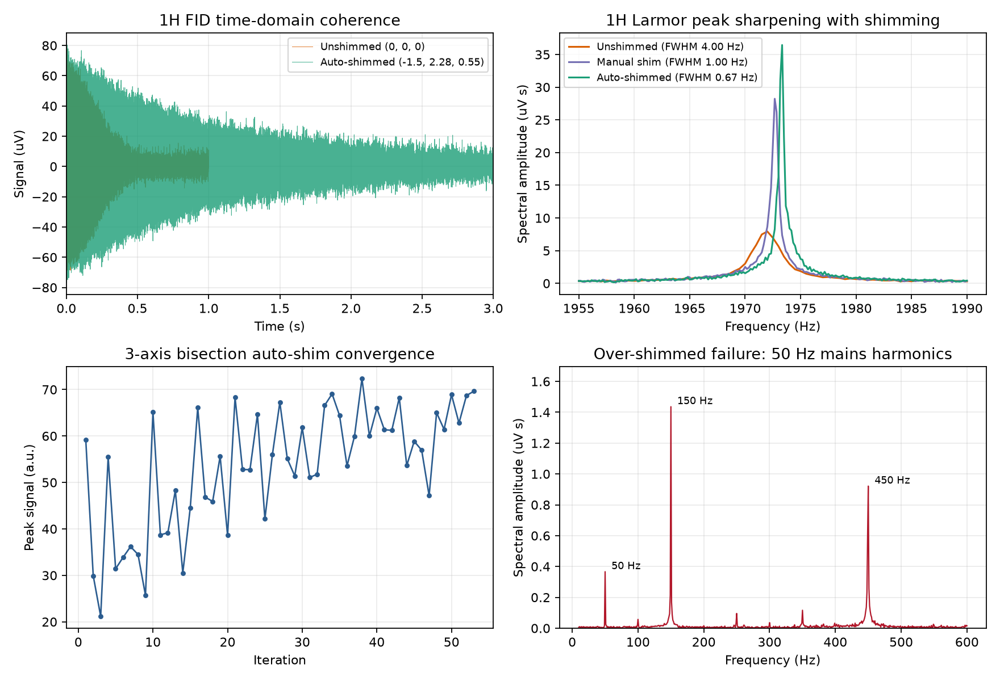
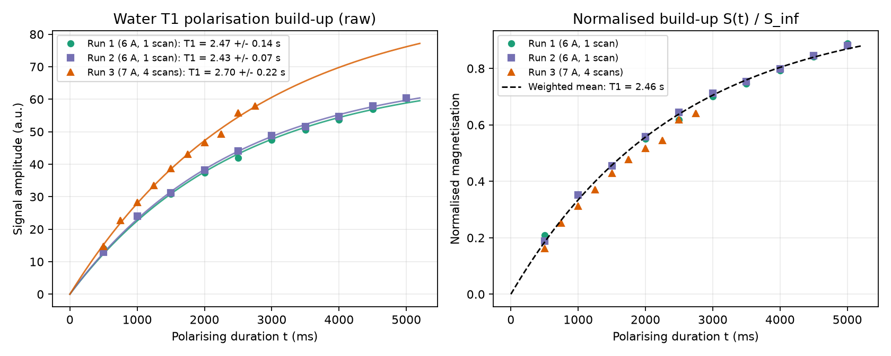
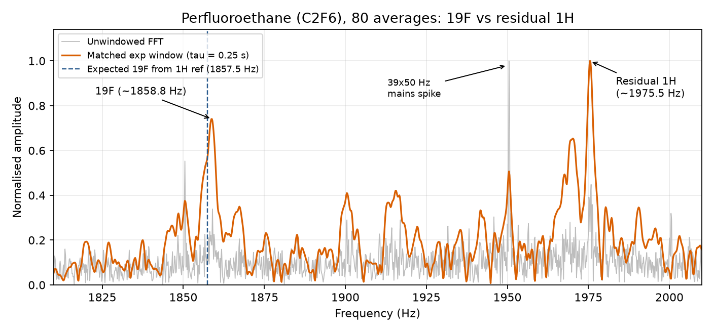
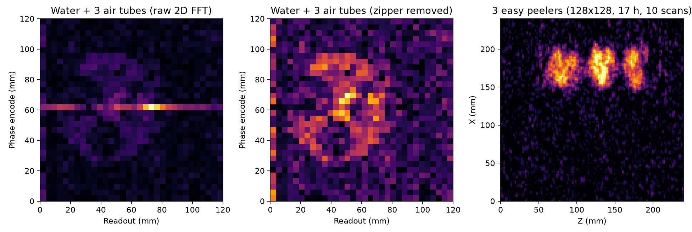

# Earth-Field NMR & 2D Spin-Echo MRI

Data analysis and plotting scripts from my 2nd-year Physics lab at the University of Nottingham (2025, ~2-3 months). I used a Magritek Terranova-MRI benchtop spectrometer to measure proton (`1H`) and fluorine (`19F`) NMR in Earth's magnetic field (`~46 uT`), tune the RF coil, shim out lab field gradients, measure `T1` in water, and run overnight 2D spin-echo MRI scans.

The Python scripts parse the raw Magritek Prospa binary files (`acqu.par`, `.1d`, `.2d`, `data.txt`) directly and regenerate the plots below.

## Summary of results

| Measurement | Result | Notes |
| --- | --- | --- |
| Local magnetic field `B0` | `46.35 uT` | Calculated from the `1H` peak at `1973.3 Hz` (phone sensor read `~45 uT`) |
| `B1` coil (`L`, `C0`) | `0.3685 H`, `4.30 nF` | Self-resonance `~4.0 kHz`, tuned to `1H` with `13.35 nF` external capacitance |
| `1H` linewidth (FWHM) | `4.00 Hz` -> `0.67 Hz` | 3-axis auto-shimming (`x=-1.5, y=2.28, z=0.55`) |
| Water `T1` (3 runs) | `2.43 s` to `2.70 s` | Weighted mean `2.46 s` from `T1Bp` polarisation build-up fits |
| `19F` in `C2F6` (80 scans) | `1858.8 Hz` | Close to `1857.5 Hz` expected from the `1H` field reference |

## Plots

### Shimming and 50 Hz mains noise

Without shimming, stray magnetic field gradients in the teaching lab dephase the water FID in under `0.5 s`, leaving a broad `4.0 Hz` peak. Running the 3-axis auto-shimmer keeps the signal coherent past `2.5 s` and narrows the `1973.3 Hz` peak down to `0.67 Hz`. Pushing the shim currents too far kills the NMR signal completely and leaves only `50 Hz` mains noise and odd harmonics (`150 Hz`, `450 Hz`).



### Water T1 relaxation

Earth's field is too weak to get a clean signal from thermal polarisation on its own, so the rig pre-polarises the sample with `6-7 A` before pulsing. Varying the polarising time (`500-5000 ms`) across three runs and fitting `S(t) = S_inf * (1 - exp(-t / T1))` gives `T1` between `2.43 +/- 0.07 s` and `2.70 +/- 0.22 s` (weighted mean `2.46 s`).



### Fluorine (19F) vs residual proton (1H) in C2F6

Averaging 80 scans on a perfluoroethane sample resolves the `19F` peak at `1858.8 Hz` alongside residual `1H` around `1975.5 Hz` (likely from moisture) and a narrow `1950 Hz` (`39 x 50 Hz`) mains spike. Applying a `0.25 s` exponential window brings out the decaying NMR peaks above the continuous mains background.



### 2D Spin-Echo MRI

Using `90 - tau_e - 180` spin-echo sequences with frequency and phase encoding gradients:

- Water bottle with 3 air tubes (`32x32`, `120 mm` FOV): the raw 2D FFT has a bright horizontal line across the middle from a phase-independent stimulated echo / DC offset. Subtracting the complex median across phase-encode steps clears it and shows the three air voids inside the water tube.
- 3 easy-peeler oranges (`128x128`, `240 mm` FOV, 10 averages, ~17 hours overnight): reconstructed from the raw k-space with phase-median subtraction and a Gaussian window centred on the echo peak.



## Lab issues and limitations

- Odd `50 Hz` mains harmonics (`150 Hz`, `450 Hz`, `1950 Hz`) showed up in most longer acquisitions since the lab wasn't shielded.
- Running `6-7 A` through the polarising coil during the 17-hour scan warmed the rig up and drifted the Larmor frequency by a few Hz.
- A `32x32x32` 3D pepper scan was cut short after 1 phase plane (`31/32` empty), so it isn't included in `data/`.

## How to run

```bash
pip install -r requirements.txt
python src/analyse_nmr.py
```

## Repo layout

```text
.
├── data/               # Raw Prospa .par, .1d, .2d, and .txt datasets
├── figures/            # Output plots generated by analyse_nmr.py
├── src/
│   ├── prospa_io.py    # Parser for Magritek Prospa binary & parameter files
│   └── analyse_nmr.py  # FFTs, T1 fits, 2D MRI reconstruction, and plotting
├── requirements.txt
├── .gitignore
└── LICENSE
```
